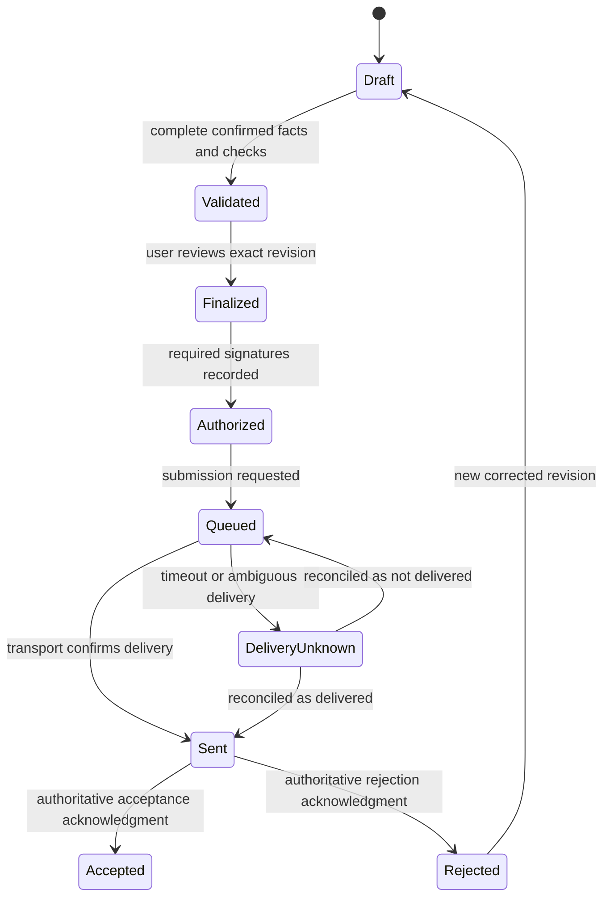

# Preparation and filing product

## End goal

Taxman is a free consumer federal tax preparation and filing product, intended to compete with paid products such as TurboTax. Calculation is a necessary first milestone. The finished experience guides a person through information collection, calculation, review, signing, submission, and the filing outcome.

Start with a narrow set of complete supported returns, initially built around W-2, 1099-INT, 1099-DIV, and the standard deduction. Define required forms, schedules, facts, and exclusions before claiming support. A handful of supported income fields does not establish that the entire return is complete.

Federal filing comes first; state returns are a later capability. Product intent does not establish release readiness or a launch date.

## Architecture to establish now

Keep these layers separate but reconcile them against the same finalized information:

1. Interview and documents collect confirmed taxpayer facts.
2. Calculation rules compute values and source-backed explanations.
3. Canonical return revisions combine facts, elections, calculations, and reporting obligations.
4. Year-specific mappings generate forms and supported submission artifacts.
5. Return-wide validation establishes preparation and filing readiness.
6. Review/signature binds authorization to an exact immutable revision.
7. Filing orchestration submits it through an authorized route and records the outcome.

Semantic tax facts remain independent of form line numbers. The canonical return holds identity/reporting information that a standalone calculation may not need. Never duplicate calculation logic in PDF generation or the transport adapter.

The first prototype should generate a draft return mapping from synthetic data and run a fake submission/acknowledgment flow. It should clearly mark both as non-production artifacts. This tests interfaces without transmitting real returns or collecting identity documents.

## Proposed lifecycle

This is a domain model to verify against the selected integration, not a statement of the IRS protocol. Keep provider and IRS status distinct. A provider receipt is not automatically IRS acceptance. Acceptance is not a guarantee of the displayed refund amount or timing.

Changes to reviewed or signed data create a new revision and invalidate authorization for the old data. Keep the old submission and acknowledgment records intact. Correcting a rejected return differs from amending an accepted one; amendment support needs its own workflow and cannot be approximated by resubmitting an accepted return.

Idempotent requests, durable submission records, and acknowledgment reconciliation are essential. A timeout cannot be interpreted as permission to send a duplicate return. Transmission IDs and signatures are private information, not analytics fields.

## Transmission route research

Compare two routes before building the live adapter:

| Route | Work to investigate |
|---|---|
| Authorized transmission partner | Supported tax years/forms, contracts, costs, security, responsibilities, test environment, signatures, acknowledgments, and data portability |
| Our own applicable IRS provider roles | Eligibility and enrollment, credentials, software development/testing, transmission, operations, and ongoing requirements |

A partner may reduce transport work; it does not establish that all of Taxman's own responsibilities disappear. Identify the applicable roles for the actual service rather than assuming an ERO enrollment alone covers an online consumer software product. Reference: [Publication 3112, IRS e-file Application and Participation](https://www.irs.gov/pub/irs-pdf/p3112.pdf).

The IRS provider application includes enrollment and suitability review, with approval potentially taking up to 45 days. This is a reason to research the route early, not a complete project launch estimate. Reference: [Become an authorized e-file provider](https://www.irs.gov/e-file-providers/become-an-authorized-e-file-provider).

MeF has XML schemas, business rules, and versioned known issues. Access and supported schema versions need to be established for the selected tax year and route. Reference: [MeF schemas and business rules](https://www.irs.gov/e-file-providers/modernized-e-file-mef-schemas-and-business-rules).

Plan software validation against the relevant testing process and supported scenarios. Passing internal tax fixtures is separate from meeting applicable IRS software requirements. Reference: [MeF Assurance Testing System](https://www.irs.gov/e-file-providers/modernized-e-file-mef-assurance-testing-system-ats).

## Filing-specific product requirements

Review identity verification, signature methods, required records, security standards, payment/refund options, timeliness, and rejected returns for the chosen role and filing method. These are product requirements to establish from official guidance, not a generic login or payment integration. Reference: [Publication 1345, Authorized IRS e-file Providers of Individual Income Tax Returns](https://www.irs.gov/pub/irs-pdf/p1345.pdf).

The user should see a guided interview, complete return review, exact calculated amounts, understandable validation messages, signature requests, submission progress, and actionable rejection corrections. Keep internal provider credentials and schema identifiers out of the ordinary user experience.

Provide copies of the prepared/filed return and relevant acknowledgment records. Explain data retention at the point of filing. Keep hypothetical estimates, confirmed returns, and filed records visibly distinct.

## Revised next-work ranking

1. Define one supported complete return, its calculation facts, reporting fields, form mappings, and independently checked examples.
2. Implement the calculation slice and minimal canonical return model together.
3. Build guided entry and draft return review with source-backed explanations.
4. Establish secure saving, versioning, and filing-identity boundaries.
5. Add the initial interest/dividend situations and necessary reporting mappings.
6. Implement a fake filing adapter, signatures contract, and rejection/unknown-delivery tests.
7. Complete the selected authorized transmission integration, required validation, and operational readiness before live filing.
8. Expand return coverage, document extraction, state returns, and annual maintenance.

Research transmission eligibility and integration constraints alongside steps 1–3. Do not let early calculator delivery redefine the end goal as estimation only.
