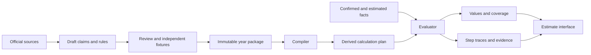

# Tax rule system

## Recommendation and alternatives

The target is easy authorship and safe extension. A graph is useful for execution and impact analysis, but should not dictate how every tax rule is written.

| Approach | Strength | Limitation | Role in TaxMan |
|---|---|---|---|
| Application conditionals | Familiar and easy to start | Dependencies, year changes, and explanations become scattered | UI plumbing only; tax logic belongs in reviewed modules |
| Giant JSON/YAML rules language | Uniform storage | Often recreates an inferior programming language | Small bounded expression vocabulary only |
| Decision tables | Reviewable eligibility and exceptions | Poor fit for complex arithmetic | Applicability and method selection |
| Pure typed functions | Excellent for complex worksheets | Metadata and traces need discipline | Reviewed algorithm modules |
| Dependency graph | Recalculation, provenance, impact analysis | Does not express legal meaning by itself | Derived calculation plan |
| Logic programming or production rules | Useful for inference and facts | Conflict/order semantics can be hard to explain and audit | Research prototype only if concrete cases justify it |
| LLM over source text | Helps find and draft interpretations | Not a deterministic or verified tax calculator | Authoring assistant, never execution authority |

Use a hybrid: typed facts + parameter tables + decision tables + expressions + pure modules. Keep the kernel small. Complexity lives in visible, source-backed tax concepts rather than a magical universal interpreter.

## Model four distinct things

1. Evidence: documents, legal references, IRS instructions, corrections, and interpretations.
2. Facts: normalized user information, dates, amounts, classifications, and chosen elections.
3. Rules: applicability, classification, computation, conflicts, and coverage behavior.
4. Results: values, calculations, explanations, unresolved questions, and revision identifiers.

Tax rules are not all arithmetic. A useful taxonomy includes definitions, eligibility tests, exclusions, elections, allocations, limits, phaseouts, carryovers, reconciliation, additional taxes, reporting requirements, and procedural obligations. Some rules affect filing without changing this year's tax number.

## Typed fact model

Represent Money as exact cents or an exact decimal, Rate as an exact rational/decimal, and dates separately from ages. Avoid floating-point arithmetic and percentage values hidden in money fields.

Every fact includes subject, jurisdiction, tax period, value status, provenance, and revision. Facts about one spouse cannot accidentally aggregate with the other's unless a rule requests household aggregation.

Fact states: confirmed, provisional, estimated, missing, not-applicable, invalid. Empty input is not zero. A sum of documents is known only when the relevant list and fields have been confirmed complete. Explicitly confirmed absence can produce zero.

Store source document amounts separately from normalized amounts. Derived facts carry the rule and input references that produced them. A 1099 field label is not the fact's legal conclusion; classification may require user answers or another worksheet.

Separate three clocks: the income tax year, source/rule publication or correction date, and user document revision. An earlier year recalculated after a rule correction is still the earlier year's tax computation.

## Rule contract

Each rule has:

- Stable semantic ID, version, jurisdiction, applicable years, and release status.
- Declared typed inputs and outputs, including semantic subject and unit.
- Explicit applicability and handling of missing facts.
- Execution kind: expression, decision table, or versioned module.
- Exact rounding policy and any statutory floors, caps, or negative handling.
- Source references with exact locators and an interpretation note.
- Explanation key and typed explanation arguments.
- Test references and capability membership.
- Relationships: prerequisites, supersedes, exception-to, mutually-exclusive-with, and method alternatives.

Do not make forms the engine's data model. Semantic values such as `income.dividends.qualified` are mapped to year-specific form lines separately. Preserve worksheet step identifiers for inspection.

See [the illustrative package](../examples/dividend-rules.json) and [draft schema](../schemas/rule-package.schema.json). These only demonstrate authoring structure; they are not a complete engine or tax package.

The example's invariant sentences are documentation, not executable validation. The real compiler must encode required invariants as typed predicates and enforce them. JSON Schema validates structure; it cannot establish legal correctness, input completeness, decision coverage, or numerical correctness by itself.

## Parameters versus rules

Thresholds, rates, indexed amounts, table ranges, and status-specific constants belong in immutable annual parameter bundles. Each parameter has units, applicability, source locator, and review state.

Do not clone an entire engine for every year. Reuse an unchanged reviewed module by explicit version reference. Compose a year manifest from module versions and parameters, then flatten it for release. Production evaluation never falls back to “latest” or walks an ambiguous inheritance chain.

Treat non-year-based revisions carefully: a continuing-use form instruction may be published in a different year from the return. Its applicability must be reviewed, not inferred from its title.

## Applicability and exceptions

Decision table conditions evaluate to true, false, unknown, or invalid. Define each table's hit policy: exactly one, at most one, or explicitly combined contributions. The compiler rejects conflicting rows and incomplete required routes where statically detectable; tests cover remaining boundaries.

Represent an exception as a specific rule with a named relationship and explicit conditions. Do not rely on file order, a global priority number, or whichever rule runs last. Method selection returns an explicit route: ordinary tax, preferential worksheet, specialized worksheet, or unresolved.

An explanation includes both the selected method and relevant rejected alternatives. “This does not apply” requires its own factual basis, not a fabricated zero.

Removing a rule cannot cause a downstream computation to quietly use zero. Disable the containing capability or select a reviewed replacement; the compiler rejects dangling dependencies and the coverage plan exposes the remaining gap. Preserve prior package versions for reproducing saved results.

## Elections and optimization

An election is a typed decision with eligible options, prerequisites, user selection, deadline context, required evidence, and review status. Never take an election just because it produces the smaller tax.

Provide comparisons of eligible choices, recording assumptions and effects on carryovers, future years, and reporting obligations. A tax-minimizing choice is not always the best financial choice. Automatic selection is allowed only when the rule itself directs the method or a permitted product workflow explicitly records user authorization.

Annual estimate inputs may contain hypothetical choices; keep them distinct from confirmed choices for a return-method estimate.

## Execution plan

Compilation validates contracts, types, source links, module versions, method conflicts, parameter completeness, jurisdiction/year consistency, and dependency integrity. Derive a dependency graph automatically from declarative references. Modules declare their dependencies and can only read the typed input object supplied to them; hidden global reads are prohibited.

Runtime sequence:

1. Validate and normalize input facts.
2. Run applicability and coverage screening.
3. Resolve eligible methods and choices, or request missing information.
4. Compute ready nodes in a stable order.
5. Emit result values and per-step traces, including skipped or blocked decisions.
6. Determine completeness for the requested output, not merely the presence of a number.

An output may be locally computable while the final refund remains blocked. Show useful intermediate numbers without suggesting the missing pieces have been handled. Scope questions still need completion before labeling a full estimate complete.

For incremental recalculation, invalidate affected descendants of changed facts or choices. Cache by fact revision, package digest, engine version, and rounding policy. Never share private result caches across households.

An eligibility decision may depend on a computed amount. Compile the combined plan rather than assuming all eligibility happens once before arithmetic. Evaluation schedules ready applicability and computation nodes together. Require an applicability result before executing the selected method.

## Circular interactions

Most calculations can be made acyclic by following reviewed worksheet steps. Detect strongly connected components during compilation. A remaining cycle is rejected unless enclosed in an approved module that defines its algorithm.

An iterative module specifies initialization, precision, convergence criterion, iteration bound, domain, and failure outcome. Prefer official worksheet procedures where available. A generic fixed-point solver is not assumed to produce the legally correct answer; rounding can create discontinuities or multiple candidates.

Validate interacting deductions, credits, and allocations as a coherent group. No promise that every provision can be represented by one formula or imported independently.

## Numeric and method policy

Store exact entered cents. Apply rounding only at documented boundaries; sum related inputs before rounding when required by the adopted method. Preserve pre-round and post-round values in traces.

Expose two explicit modes: continuous annual planning and return-method estimate. They may differ at lookup or rounding boundaries. Tables are first-class methods, not approximations reconstructed from bracket rates. The [IRS 2025 tax tables](https://www.irs.gov/publications/p1040) are a reference for method validation.

Preferential-rate amounts must be allocated in the context of other taxable income. Do not multiply all dividends by a single rate or double count qualified dividends as additional income. The sample below only explains dividend classification; it does not calculate tax or establish holding-period eligibility.

## Explanation output

A result must contain rule/package versions, actual inputs and their provenance, operations and intermediate steps, applicability decisions, rounding, parameter references, evidence references, coverage status, and outstanding questions.

The friendly view uses reviewed templates. The detailed view shows a worksheet and expandable dependency trail. Citations support particular claims, not merely the document as a whole. The calculation trace is the source of explanations; an LLM must not invent the rationale after receiving a final number.

Source traceability proves how TaxMan reached an answer, not that its interpretation is correct. Independent review and numerical tests are separate requirements.

## Extension example: foreign tax paid

First preserve the document box as a fact and create a coverage blocker with evidence. Later add eligibility decisions, applicable credit/deduction alternatives, user choice, computation, limit interactions, and form mapping. Then remove the blocker only for cases fully covered by the reviewed module.

That workflow adds a capability without editing wage aggregation or replacing the engine. It also demonstrates why importing one apparent tax rule cannot necessarily add support for an entire situation.
